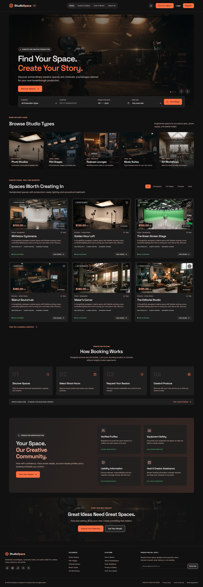
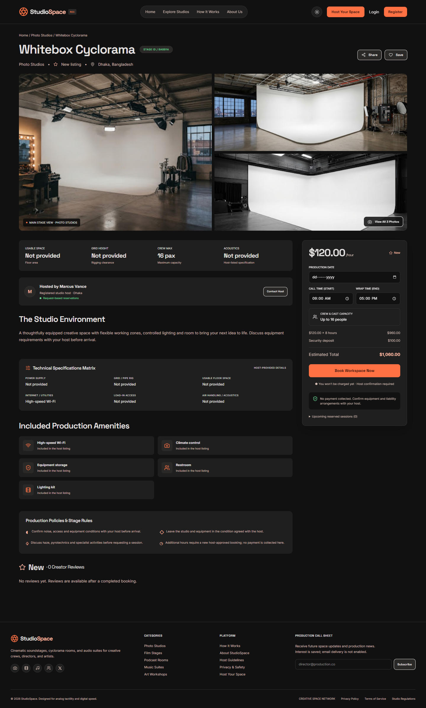
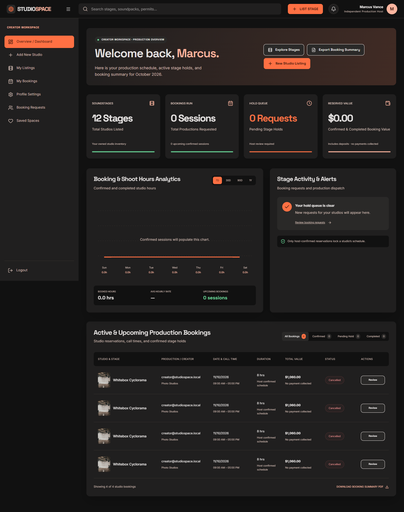

# StudioSpace

A full-stack marketplace for discovering and booking creative spaces. Creators can explore photo studios, film stages, podcast rooms, music suites and art workshops. Hosts can publish listings and manage booking requests.

[Live application](https://studio-space-sepia.vercel.app/) · [API health](https://studiospace-api-bice.vercel.app/api/health) · [API reference](docs/API_DOCUMENTATION.md) · [Deployment guide](docs/VERCEL_DEPLOYMENT.md)

## Screenshots

Desktop screenshots from the local design review, using seeded demonstration data. Listings, account names and booking records illustrate the interface; live content may differ.

### Homepage

Studio discovery, production categories and featured spaces.

View the full homepage

### Studio details

Image gallery, production specifications, amenities and booking estimates.

View the studio details page

### Dashboard

Host workspace with listings, booking activity and production summaries.

## Features

- **Studio discovery** with search, category, location and price filters, sorting, pagination and shareable filter URLs.
- **Accounts** with email/password registration, Google sign-in, protected pages and database-backed sessions.
- **Host workspace** for listing creation, editing, production specifications, image uploads and pause/resume controls.
- **Booking management** with availability checks, price snapshots, host approval or rejection, creator cancellation and booking history.
- **Personal workspace** with saved studios, profile editing, completed-booking reviews and booking exports.
- **Responsive interface** with light and dark themes, mobile navigation, accessible dialogs and reduced-motion support.

## Technology

| Layer | Tools |
| --- | --- |
| Frontend | Next.js App Router, React, TypeScript |
| Interface | Tailwind CSS, Radix UI, Lucide, Motion, Swiper |
| Forms and API state | React Hook Form, Zod, TanStack Query |
| Backend | Express 5, TypeScript, Mongoose |
| Database | MongoDB replica set locally, MongoDB Atlas in production |
| Authentication | bcrypt, JWT, HTTP-only cookies, Google OAuth |
| Images and documents | Sharp, PDFKit |
| Verification | Vitest, Supertest, Playwright, ESLint |
| Hosting | Separate Vercel frontend and API projects |

## Architecture

The repository uses npm workspaces for the frontend and API.

~~~text
StudioSpace/
├── client/
│   ├── app/                  Next.js routes and layouts
│   ├── components/           Shared interface components
│   ├── features/             Feature-specific screens and interactions
│   ├── lib/                  API client and frontend utilities
│   ├── public/               Images and bundled fonts
│   └── tests/                Browser tests
├── server/
│   ├── app.ts                Vercel Express entry point
│   ├── src/
│   │   ├── config/           Environment, OAuth and upload configuration
│   │   ├── controllers/      Request handlers
│   │   ├── middleware/       Authentication, request and error handling
│   │   ├── models/           MongoDB models
│   │   ├── routes/           API route registration
│   │   ├── services/         Application services
│   │   └── validators/       Request schemas
│   └── tests/                API and local startup tests
├── scripts/                  Build and local database preparation
└── docs/                     Architecture, API and deployment documentation
~~~

The browser sends requests to the frontend's same-origin /api routes. Next.js rewrites those requests to Express using SERVER_URL. Authentication cookies stay on the frontend origin. The API owns database access, session validation, authorization and booking transactions.

## Live environments

| Service | Address |
| --- | --- |
| Website | https://studio-space-sepia.vercel.app |
| API origin | https://studiospace-api-bice.vercel.app |
| Database health | https://studiospace-api-bice.vercel.app/api/health |

A successful API health response is:

~~~json
{
  "status": "ok",
  "database": true
}
~~~

The API exposes specific routes. Its root path returns an endpoint-not-found response because no root handler is defined.

## Local setup

### Requirements

- A Node.js version supported by the root package.json, including Node.js 22.12+ or 24.x.
- npm and internet access for initial dependency and MongoDB binary downloads.
- Google OAuth credentials to test Google sign-in.

### Start with the bundled local database

Run from the repository root:

~~~powershell
npm install --workspaces=false
npm run prepare:local
npm run local
~~~

Open http://localhost:3000. The runner starts a persistent MongoDB replica set, seeds development data, starts Express on port 4000 and starts Next.js on port 3000. Stop it with Ctrl+C.

The database directory defaults to work/local-mongo and MongoDB uses port 27018. The Windows preparation script downloads and verifies the MongoDB executable. Other platforms use the launcher's platform download.

The --workspaces=false installation option supports the existing root dependency layout without requiring Windows workspace links.

### Development accounts

The local seed provides these accounts:

| Account | Email | Password |
| --- | --- | --- |
| Host | host@studiospace.local | StudioPass1 |
| Creator | creator@studiospace.local | StudioPass1 |

Use these accounts with a development database. Production users register through the application. The local runner generates a signing secret when one is absent, so a restart can require signing in again.

### Use an existing database

Bookings use MongoDB transactions, so use a replica set or MongoDB Atlas. Export MONGODB_URI, JWT_SECRET and CLIENT_URL in your shell, then run npm run dev from the repository root. The separate API workspace also loads server/.env.

A local server/.env can contain:

~~~dotenv
MONGODB_URI=mongodb://127.0.0.1:27017/studiospace?replicaSet=rs0
JWT_SECRET=replace-with-a-random-secret-of-at-least-32-characters
CLIENT_URL=http://localhost:3000
~~~

The MongoDB instance in this example must already be configured as a replica set. For Atlas, use its connection string with the intended database name.

Run npm run seed only to populate a development database. The bundled npm run local runner manages its own local database.

## Environment variables

Keep private values in local environment files or Vercel environment settings.

| Variable | Location | Purpose |
| --- | --- | --- |
| MONGODB_URI | API | MongoDB connection string with the intended database name |
| JWT_SECRET | API | Random session-signing secret of at least 32 characters |
| CLIENT_URL | API | Exact frontend origin without a trailing slash |
| UPLOAD_STORAGE | API | Set to mongodb for hosted image persistence |
| SERVER_URL | Frontend | API origin used by Next.js rewrites, without an /api suffix |
| GOOGLE_CLIENT_ID | API | Google OAuth web client ID |
| GOOGLE_CLIENT_SECRET | API | Google OAuth web client secret |
| GOOGLE_CALLBACK_URL | API | Registered Google callback URL |
| PORT, API_PORT | Local runner | Frontend and API port overrides |
| LOCAL_MONGO_PORT, LOCAL_MONGO_DB_PATH | Local runner | Database port and persistent directory |
| NEXT_DIST_DIR, STUDIOSPACE_TEST_URL | Development and tests | Alternate Next.js output directory and browser test origin |

For Google sign-in with npm run local, export the OAuth variables before starting the runner.

## Vercel deployment

Create separate API and frontend projects connected to this repository.

| Setting | API project | Frontend project |
| --- | --- | --- |
| Root directory | server | client |
| Framework | Express | Next.js |
| Install and build settings | Preset defaults | Preset defaults |
| Database connection | MONGODB_URI | — |
| Signing secret | JWT_SECRET | — |
| Frontend origin | CLIENT_URL=https://studio-space-sepia.vercel.app | — |
| Image storage | UPLOAD_STORAGE=mongodb | — |
| API origin | — | SERVER_URL=https://studiospace-api-bice.vercel.app |

Enable access to source files outside the root directory for workspace dependencies and shared build scripts. Configure Atlas network access for the deployed API.

Deploy the API first, verify /api/health, then deploy the frontend. Changing SERVER_URL requires rebuilding the frontend because the rewrite target is configured at build time. API environment changes require redeploying the API.

The server build uses tsconfig.build.json to exclude the local MongoDB launcher from production compilation. Hosted requests enter through server/app.ts and connect to Atlas on demand.

See the [deployment guide](docs/VERCEL_DEPLOYMENT.md) for networking, preview environments and upload migration.

## Google sign-in

Create a Web application OAuth client in Google Cloud. Register this production callback under authorized redirect URIs and set the API's GOOGLE_CALLBACK_URL to the same value:

~~~text
https://studio-space-sepia.vercel.app/api/auth/google/callback
~~~

Set GOOGLE_CLIENT_ID and GOOGLE_CLIENT_SECRET in the API project and redeploy. When Google's consent configuration is in testing mode, add the intended test accounts.

The callback uses the frontend origin so the OAuth state cookie and resulting session remain on the origin used by the browser. The API verifies Google tokens and email verification. Existing password accounts require their original sign-in method.

For local development through the frontend proxy, register http://localhost:3000/api/auth/google/callback separately and use that value for GOOGLE_CALLBACK_URL.

Google requires an exact match between the requested and registered redirect URI. See the [official OAuth server flow](https://developers.google.com/identity/protocols/oauth2/web-server).

## API overview

| Method | Endpoint | Purpose |
| --- | --- | --- |
| GET | /api/health | API and database connection status |
| POST | /api/auth/register | Create a password account |
| POST | /api/auth/login | Start a session |
| POST | /api/auth/logout | Revoke the current session |
| GET | /api/auth/me | Read the signed-in user |
| GET | /api/auth/google | Begin Google sign-in |
| GET | /api/auth/google/callback | Complete Google sign-in |
| GET, PATCH | /api/users/me | Read or update the profile |
| GET, POST | /api/studios | Search studios or create a listing |
| GET, PATCH, DELETE | /api/studios/:id | Read, edit or delete a listing |
| GET | /api/studios/:id/availability | Check availability |
| POST | /api/bookings | Request a booking |
| GET | /api/bookings/mine | Read personal bookings |
| GET | /api/bookings/host | Read bookings for owned studios |
| GET, POST | /api/wishlist | Read or add saved studios |
| GET, POST | /api/studios/:id/reviews | Read or submit reviews |
| POST | /api/uploads | Upload an image |

Mutations require an allowed Origin and the x-studiospace header set to 1. Protected routes also require a valid session cookie. The frontend API client supplies the header and cookie credentials.

See the [API reference](docs/API_DOCUMENTATION.md) for additional routes, payloads and access rules.

## Data integrity and security

Sessions have signed HTTP-only cookies and hashed database records with expiry and per-session logout revocation. Production cookies use Secure and SameSite=Lax. Middleware checks session validity and account existence before granting access.

Studio changes and booking actions enforce ownership. Booking creation, confirmation and listing deletion use MongoDB transactions with conflict retries. Confirmed bookings cannot overlap. Adjacent bookings are allowed.

Listings with booking history cannot be deleted. Reviews require a completed booking and are limited to one per user and studio. Passwords are hashed with bcrypt. Request validation, rate limits, security headers and origin checks protect the API.

## Images and storage

Bundled images live in client/public/images. User uploads are decoded with Sharp, resized up to 1920 pixels wide without enlargement and converted to PNG.

| Environment | Storage | Upload limit |
| --- | --- | --- |
| Local development | client/public/images | 10 MiB |
| Hosted API | MongoDB | 4 MiB |

Hosted requests must also fit Vercel's payload limit, including multipart overhead. Existing local upload files need migration when their listings move to the hosted database.

Fonts are bundled under client/public/fonts with their licenses. Asset and design review details are recorded in [DESIGN-AUDIT.md](DESIGN-AUDIT.md).

## Development commands

Run from the repository root unless stated otherwise.

| Command | Purpose |
| --- | --- |
| npm run local | Start the local database, API and frontend |
| npm run prepare:local | Prepare the local MongoDB executable |
| npm run dev | Start both workspaces against a configured database |
| npm run seed | Seed a development database |
| npm run typecheck | Check both workspaces |
| npm run lint | Run ESLint |
| npm test | Run Vitest tests |
| npm run test:e2e | Run Playwright browser tests |
| npm run build | Build the API and frontend |
| npm run build -w server | Build the production API |
| npm run start -w client | Start the compiled Next.js application |

API tests use their own MongoDB replica set. Playwright starts the local application when needed and can reuse a running server. On Windows it uses installed Google Chrome. On other platforms, install Chromium with npx playwright install chromium before running browser tests.

After building, a separate Node.js API can be started with node server/dist/src/index.js from the repository root with the environment exported. Vercel uses the default export in server/app.ts.

Historical verification reports record checks performed at the time of each audit. Run the relevant checks for your changes.

## Documentation

- [Architecture](docs/ARCHITECTURE.md)
- [Folder structure](docs/FOLDER_STRUCTURE.md)
- [Component dependency map](docs/COMPONENT_DEPENDENCY_MAP.md)
- [API reference](docs/API_DOCUMENTATION.md)
- [Development guide](docs/DEVELOPMENT_GUIDE.md)
- [Vercel deployment](docs/VERCEL_DEPLOYMENT.md)
- [Coding standards](docs/CODING_STANDARDS.md)
- [Git workflow](docs/GIT_WORKFLOW.md)
- [Release audit](docs/RELEASE_AUDIT.md)
- [Verification report](VERIFICATION.md)
- [Design audit](DESIGN-AUDIT.md)

## Contributions and scope

Use a focused feature branch, follow the existing architecture and run checks relevant to your changes before opening a pull request. Review the [coding standards](docs/CODING_STANDARDS.md) and [Git workflow](docs/GIT_WORKFLOW.md).

StudioSpace supports studio discovery and booking management. Payment collection, transactional email delivery and account recovery are outside the current implementation. Booking PDFs summarize bookings. Footer social links currently lead to platform homepages.

A repository-wide software license has not been provided. Bundled font licenses remain with their assets.
